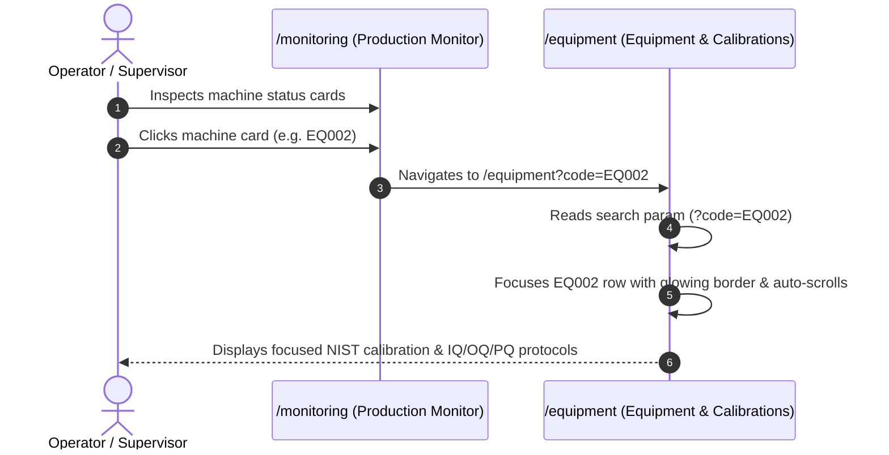
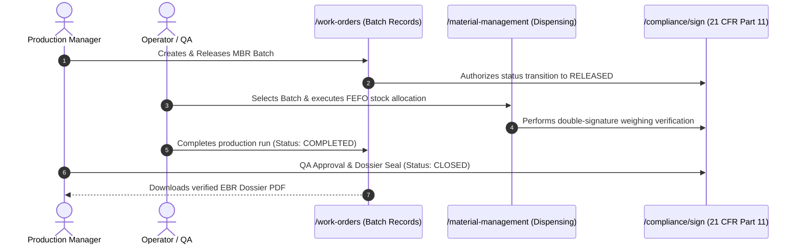
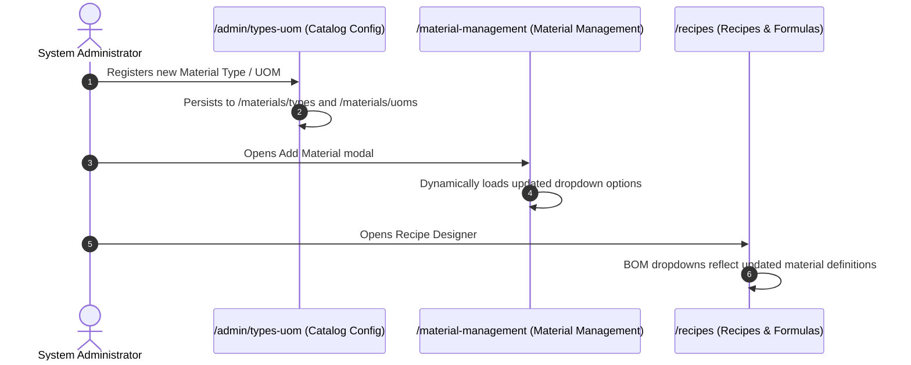

# UGAM MES - Information Architecture & Page Navigation Guide

## 1. System Overview
UGAM MES is an enterprise-grade Manufacturing Execution System designed for regulated industries (Food & Beverage, Life Sciences, and Pharmaceuticals). It enforces GAMP 5 validation principles, FDA 21 CFR Part 11 electronic records/signatures, GS1 supply chain serialization, and FSMA Section 204 Critical Tracking Events.

---

## 2. High-Level Architectural Hierarchy

```mermaid
graph TD
    A["🔐 /login (Authentication & JWT Issuance)"] --> B["🖥️ Protected Layout Shell (Top Nav + Left Accordion Sidebar)"]
    
    subgraph Operations ["1. Operations Pillar"]
        B --> OP1["/dashboard (Executive Dashboard)"]
        B --> OP2["/monitoring (Production Monitoring & Status Legends)"]
        B --> OP3["/schedule (Gantt Scheduling & Timeline)"]
        B --> OP4["/operator (Operator Workstation & Touch Mode Console)"]
    end

    subgraph MaterialsRecipes ["2. Materials & Formulation Pillar"]
        B --> MR1["/material-management (Material Master, Vendors, GRN, FEFO Stock, Dispensing)"]
        B --> MR2["/recipes (Master Formulas, BOM Specifications & GAMP 5 CPP)"]
    end

    subgraph QualityCompliance ["3. Quality & Compliance Pillar"]
        B --> QC1["/work-orders (Manufacturing Batch Records & EBR Dossiers)"]
        B --> QC2["/quality (Quality & Statistical Process Control - SPC)"]
        B --> QC3["/equipment (Asset Register, Calibrations & IQ/OQ/PQ Qualifications)"]
        B --> QC4["/compliance (21 CFR Part 11 Electronic Signatures & Audit Logs)"]
    end

    subgraph TrackTrace ["4. Track & Trace Pillar (GS1 / FSMA 204)"]
        B --> TT1["/trace/dashboard (Traceability KPI Dashboard)"]
        B --> TT2["/trace/products (GTIN Product Registry)"]
        B --> TT3["/trace/batches (Batch Lot Campaigns)"]
        B --> TT4["/trace/trace (Multi-tier Genealogy Graph)"]
        B --> TT5["/trace/events (Critical Tracking Events CTE/KDE)"]
        B --> TT6["/trace/shipments (Distribution Ledger & SSCC-18)"]
        B --> TT7["/trace/recall (Targeted Mock Recall Engine)"]
    end

    subgraph Administration ["5. Administration Pillar (GAMP 5 Role Matrix)"]
        B --> AD1["/admin/material (Material Master Config)"]
        B --> AD2["/admin/equipment (Plant & Equipment Asset Hierarchy)"]
        B --> AD3["/admin/types-uom (Material Types & Standardized UOM)"]
        B --> AD4["/admin/users (User Accounts & Role Mapping)"]
        B --> AD5["/admin/standards (GS1/Part 11/EPCIS Webhooks)"]
        B --> AD6["/admin/api-docs (REST API Playground)"]
    end

    subgraph Support ["6. Support Pillar"]
        B --> SP1["/help (Help Center & Standard Operating Procedures)"]
    end
```



---

## 3. Complete Navigation Sitemap & Route Directory

| Pillar / Group | Route Path | Page Label | Key Sub-Tabs / Views | Target User Roles |
| :--- | :--- | :--- | :--- | :--- |
| **Authentication** | `/login` | Secure Login | Show/Hide Password, Credential Authentication | All Roles |
| **Operations** | `/dashboard` | Executive Dashboard | Factory OEE, Production Output, Scrap %, Active Alarms | Management, Supervisor |
| | `/monitoring` | Production Monitor | Real-time Machine Status (Running 🟢, Idle 🟡, Breakdown 🔴, Setup 🔵, Maintenance 🟣), Machine Card Detail Links | Operator, Supervisor |
| | `/schedule` | Gantt Schedule | Drag-and-Drop Batch Timelines, Line Loadings | Production Manager |
| | `/operator` | Operator Station | Touch Workstation, Step Execution, Scrap Counter | Machine Operator |
| **Materials & Recipes** | `/material-management` | Material Management | 1. Material Master<br>2. Qualified Vendors<br>3. Goods Receipt (GRN)<br>4. FEFO Stock & Location<br>5. Weighing & Dispensing Station | Warehouse, Supervisor, QA |
| | `/recipes` | Recipes & Formulas | Versioned Master Formulas, BOM Specification, GAMP 5 CPP Instructions, 3D STL/Image Preview | Formulator, Production Manager |
| **Quality & Compliance** | `/work-orders` | Batch Records | MBR Initiation, Campaign Run States (PLANNED ➔ RELEASED ➔ IN_PROGRESS ➔ COMPLETED ➔ CLOSED), EBR PDF Export | Production Manager, QA |
| | `/quality` | Quality & SPC | In-process QC Inspections, Deviation Management, CAPA Tracker, SPC X-bar/R Charts | Quality Assurance, QA Engineer |
| | `/equipment` | Equipment & Calibrations | 1. Asset Register<br>2. NIST Calibration Certs<br>3. IQ/OQ/PQ Validation Protocols<br>4. Daily Calibration Checklists | Maintenance, Validation Lead |
| | `/compliance` | Compliance & Audits | 21 CFR Part 11 Audit Trail, Cryptographic Verification, Electronic Signature History | Compliance Auditor, QA Lead |
| **Track & Trace** | `/trace/dashboard` | Trace Dashboard | FSMA 204 KPIs, Active Recall Risk, Serialization Stats | Supply Chain, QA |
| | `/trace/products` | Product Registry | GS1 GTIN Catalog, Storage Specs | Supply Chain, Master Data |
| | `/trace/batches` | Batch Campaigns | Work Order Lot Tracing, Expiry Tracking | Supply Chain, Production |
| | `/trace/trace` | Genealogy Trace | Forward & Backward Trace Tree, Interactive Flow | QA, Compliance Officer |
| | `/trace/events` | Milestone Events | Critical Tracking Events (CTE) & Key Data Elements (KDE) | Supply Chain, Auditor |
| | `/trace/shipments` | Shipments Ledger | Outbound Dispatch, SSCC-18 Pallet Serialization | Warehouse Logistics |
| | `/trace/recall` | Recall Simulator | Targeted Batch Recall Simulator & Impact Assessment | QA Director, Legal |
| **Administration** | `/admin/material` | Material Master | Create & Register Materials | System Admin |
| | `/admin/equipment` | Equipment Assets | Plant Hierarchy, Area & Machine Allocation | System Admin |
| | `/admin/types-uom` | Material Types & UOM | Dynamic Material Categories & Measurement Units Catalog | System Admin |
| | `/admin/users` | Users & Roles | Account Roster, GAMP 5 Role Matrix, Password Resets | System Admin |
| | `/admin/standards` | Standards & Serialization | GS1, 21 CFR Part 11, EPCIS Webhook Configuration | System Admin |
| | `/admin/api-docs` | API Integration Guide | Interactive REST API Sandbox Playground | Developers, Integrators |
| **Support** | `/help` | Help Center | Standard Operating Procedures (SOPs), MES User Guide | All Roles |

---

## 4. Global Navigation Shell & Header Layout

```
+-------------------------------------------------------------------------------------------------------------------------+
| [LOGO] UGAM MES - Next Gen Manufacturing Execution System     [TOUCH MODE]  [DARK/LIGHT]  [🔔 (ALERTS)] [USER PROFILE | LOGOUT] |
+------------------------------------+------------------------------------------------------------------------------------+
|  LEFT ACCORDION SIDEBAR            |  MAIN WORKSPACE VIEWPORT                                                           |
|  -----------------------           |  -----------------------                                                           |
|  ▼ Operations                      |  Breadcrumbs / Page Title                                                          |
|    • Executive Dashboard           |                                                                                    |
|    • Production Monitor            |  +------------------------------------------------------------------------------+  |
|    • Gantt Schedule                |  | Content Cards / Interactive Tables / Modals                                  |  |
|    • Operator Station              |  |                                                                              |  |
|  ► Materials & Recipes             |  |                                                                              |  |
|  ► Quality & Compliance            |  |                                                                              |  |
|  ► Track & Trace                   |  |                                                                              |  |
|  ► Administration                  |  |                                                                              |  |
|  ► Support                         |  |                                                                              |  |
|                                    |  +------------------------------------------------------------------------------+  |
+------------------------------------+------------------------------------------------------------------------------------+
```

### Global Header Controls:
1. **Touch / Factory Mode Switcher:** Switches the UI between the high-density desktop management layout and high-contrast, large touch-target display for ruggedized shopfloor tablets.
2. **Light / Dark Mode Switcher:** Toggles dynamic theme styling with instantaneous CSS class and `data-theme` updates.
3. **Interactive Alarms & Notifications Drawer:**
   - Displays real-time WebSocket alarms with **severity indicators** (Critical 🔴, Warning 🟡, Info 🔵).
   - **Click-Outside Dismissal:** Clicking anywhere on the screen closes the drawer.
   - **Click-Through Navigation:** Clicking an alarm automatically marks it as read, closes the popover, and navigates directly to the affected equipment or process view.
   - **Badge Clearing:** The red unread counter badge automatically decrements and hides when all alarms are read.
4. **Active User Profile & Logout:** Displays current user name, GAMP 5 role, and secure session teardown.

---

## 5. Key Cross-Page Navigation Flows

### Flow A: Equipment Monitoring ➔ Asset Calibration View
1. Operator navigates to **Production Monitor** (`/monitoring`).
2. Identifies a machine flagged with 🟣 **Maintenance / Calibration** status (e.g., `EQ002` Steam Kettle).
3. Clicks the equipment card or the `"View Calibrations ➔"` link.
4. The system navigates to `/equipment?code=EQ002`.
5. The **Equipment & Calibrations** page highlights `EQ002`, displays a focused asset header banner, and auto-scrolls directly to the machine's calibration records.



---

### Flow B: Batch Campaign Execution ➔ Dispensing ➔ EBR Release
1. Production Manager initiates a new Batch Campaign in **Batch Records** (`/work-orders`).
2. Transitions work order status: `PLANNED` ➔ `RELEASED` with a **21 CFR Part 11 Electronic Signature**.
3. Warehouse operator navigates to **Material Management** (`/material-management` ➔ *Weighing & Dispensing Station*).
4. Selects the active Batch Campaign and triggers **FEFO (First-Expired, First-Out)** stock allocation.
5. Performs weighing balance with dual-operator electronic signoff.
6. Once production finishes, supervisor transitions batch to `COMPLETED` and QA signs off `CLOSED` to generate the **Electronic Batch Record (EBR) PDF dossier**.



---

### Flow C: Material Master & Dynamic Catalog Maintenance
1. Administrator opens **Administration** ➔ **Material Types & UOM** (`/admin/types-uom`).
2. Adds a new category (e.g., `EXCIPIENT`) or Unit of Measure (e.g., `ML`).
3. The catalog immediately persists into the database and syncs across:
   - **Admin Material Master** (`/admin/material`)
   - **Material Master Definition Modal** (`/material-management`)
   - **Recipe Bill of Materials (BOM)** (`/recipes`)



---

## 6. Security & Authorization Matrix

| User Role | Operations | Materials & Recipes | Quality & Compliance | Track & Trace | Administration |
| :--- | :---: | :---: | :---: | :---: | :---: |
| **ADMIN** | Full View | Full CRUD | Full CRUD + Sign | Full CRUD | Full Access |
| **PRODUCTION_MANAGER** | Full Control | Full CRUD | Release & Close MBR | Full Control | Read-Only |
| **SUPERVISOR** | Line Execution | View & Dispense | Batch Start / Pause | Full View | Read-Only |
| **OPERATOR** | Touch Console | Dispense Run | Read / Log Scrap | View Genealogy | No Access |
| **QUALITY_ENGINEER** | View | GRN Inspection Release | QA Signoff / CAPA / EBR | Recall Simulator | No Access |
